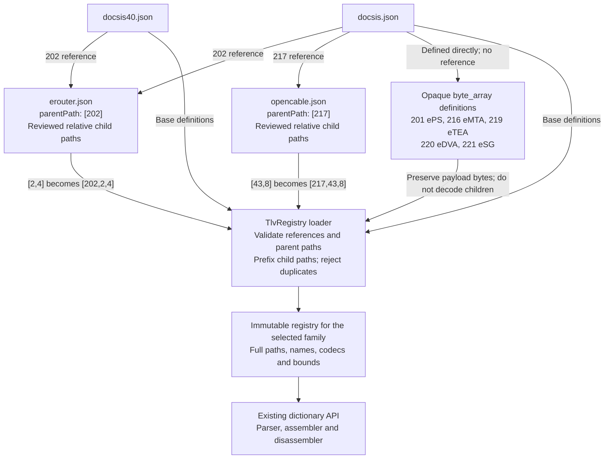

# OSCAR architecture

## Embedded-device catalogs

Status: DOCSIS and DOCSIS 4.0 attach the reviewed eRouter subset.
Regular DOCSIS also attaches OpenCable/eSTB. Selected legacy definitions have moved to shared source catalogs.
eMTA remains subject to verification of its specification and provisioning format.

### Ownership and attachment

Base family catalogs own outer embedded-device containers. Service catalogs own
relative child paths. Each base parent definition carries its own `reference`:
`[202]` references `erouter.json`; regular DOCSIS `[217]` references
`opencable.json`. All reviewed children are loaded. There is no attachment
array, selection allowlist or separate profile file.

`reference` is a local filename, not a URL or JSON Schema `$ref`.
The service's `parentPath` must match the referencing definition.
For example, eRouter `[2,4]` becomes `[202,2,4]`. Base catalogs own applicability.
DPoE, DPoG and DOCSIS 4.0 require separate applicability decisions. eMTA standalone
PacketCable provisioning must not be conflated with embedded DOCSIS settings.

Each family is loaded separately; the diagram does not imply that DOCSIS and
DOCSIS 4.0 definitions are merged. Only regular DOCSIS enables the eSTB reference
and the five opaque placeholders. Composition resolves definitions, not the
order of TLV instances in a configuration file.

### Service catalog contract

All registries use the [common TLV JSON format](tlv-registry-format.md) and
[JSON Schema](tlv-registry.schema.json), including eRouter and OpenCable.
Definitions contain the same `TlvDefinition` fields as DOCSIS: `path`, `name`,
`codec`, `lengthMin`, `lengthMax`, `lengthBytes`, `supportedVersion`,
`maxInstances`, and `description`. No separate `kind`/`length` translation exists.

Embedded catalogs add only a `parentPath` header and relative paths. Their
entries pass through the same strict deserializer and registry validation.
Detailed specification notes and deferred definitions live in the corresponding
skill's `references/tlv-notes.md`, not a second runtime JSON schema. Base
parent references control activation and family applicability.

### Loader composition and validation

The loader validates the base catalog and every service before publishing
an immutable registry. Resolve catalog references only within the configured
catalog root; reject traversal, missing files, unsupported schema versions and
recursive includes. This initial design permits attachments to base containers,
not recursive service-to-service imports.

Validate the attachment is a container, expand relative paths, and reject missing
parents, duplicate paths, case-insensitive sibling-name collisions, invalid lengths
and incompatible codecs. No last-definition-wins merging. Unresolved definitions remain in source notes, outside runtime catalogs; a
missing referenced catalog is rejected. Declare omitted settings
rather than claiming full coverage. Composition changes paths and the inherited
family version, not codec names or payload widths.

Keep the public dictionary API based on full numeric paths. Migrate existing
202 children out of base catalogs atomically with loader activation so definitions
have a single active owner. Preserve existing parser names where compatible;
report changes such as legacy `202.43.11` versus source-defined `202.11` and provide
explicit compatibility/error behavior. Never silently reinterpret an old path.

### Configuration order, integrity and secrets

Definition lookup order is not configuration instance order. Preserve repeated
containers, children, unknown data and encounter order; B.3 treats successive
202 containers as successive portions of one eRouter configuration. Do not sort
instances during composition, editing or export. Recompute MICs only through the
existing configuration integrity pipeline after actual content changes.

Sensitivity metadata applies to display/logging, not stored bytes. Parent hex
previews must respect sensitive descendants. Synthetic credentials are required
for tests and published examples.

### Delivery checklist

- [x] Extract and verify the eRouter I21 source and provenance.
- [x] Define embedded-service ownership and attachment architecture.
- [x] Build the relative-path eRouter catalog with source constraints.
- [x] Allow repeated eRouter parents in both DOCSIS families; verify order and MICs.
- [x] Add structural and source-boundary catalog regression coverage.
- [ ] Resolve ambiguous widths, access-view range and OID representation.
- [x] Implement direct parent-reference composition and fail-fast validation.
- [x] Remove base-owned service children and document compatibility below.
- [ ] Verify codecs, parser/export integration and value constraints.
- [x] Test subset wire bytes, repeated containers and complete-file MIC round trips.
- [ ] Verify in-memory round trips for every existing family after activation.
- [x] Add DOCSIS 4.0 user examples for the enabled subset.
- [ ] Integrate editor-specific applicability and sensitivity metadata.
- [x] Review OpenCable/eSTB I17 and activate the verified subset beneath 217.
- [x] Verify eSTB SNMP/vendor encodings and repeated instances.
- [x] Allow repeated DOCSIS eSTB parents; test order, bytes and MIC round trips.
- [ ] Validate eSTB provisioning on hardware and device-specific dependencies.
- [ ] Review eMTA specifications before adding its catalog.

### Enabled eRouter subset

Both DOCSIS families declare parent 202 with `maxInstances: -1`. eRouter I21
Annex B.3, printed p.87 explicitly permits repeated containers and treats their
children as one configuration in encounter order. Child-specific repetition
rules still apply. `EmbeddedProfileTest` checks this registry contract, independent
wire bytes, interleaved containers and complete-file MIC round trips for both
families.

Both base catalogs attach 202.1, 202.2.1–6, 202.3, 202.10, 202.12, 202.13 and
202.42, with the 202.2 container owned by eRouter. Both families use the same
reviewed subset. DPoE is unchanged.

### Compatibility and opaque eSAFE payloads

Legacy unverified DOCSIS definitions 202.43 (including .8/.11), 202.53
(including .1–.4 and .2.1/.2.2), 202.54 (including .1–.4), and 202.2.7
are deferred, not copied into the reviewed catalog. Inputs using these settings
are unsupported and must fail rather than silently dropping their contents.
This is an intentional compatibility restriction pending specification/codec
verification. Standalone 217.8 is removed; the supported VendorID is 217.43.8.
25.14 MaximumDownstreamLatency is grouped after 25.13 in catalog order.

DOCSIS 201 (ePS), 216 (eMTA), 219 (eTEA), 220 (eDVA), and 221 (eSG)
are opaque hex payloads, without invented child definitions. Users supply only
payload bytes; OSCAR writes the outer type and length. Reserved 203–215, 218,
and 222–231 are not assigned placeholder service names. This does not enable
these services in DOCSIS 4.0.

Authority: MULPI I21 C.3.2 delegates assignments to
[CM-SP-eDOCSIS-I30-190213 section 5.2.8.1, Table 5](https://account.cablelabs.com/server/alfresco/2cc53697-0e59-4983-a5ae-c08d4ab70136),
printed pp.46–47. Each opaque instance is bounded to 254 payload octets;
child semantics are not validated. No automatic fragmentation is provided.

D4 uses MULPI I12 Table 117 and C.3.2, p.848, for eSAFE applicability; eRouter
I21 B.3–B.4 supplies type 202 and child encodings. Variable payloads are bounded
by one-octet TLV lengths; no automatic fragmentation is introduced. Registry
metadata describes value constraints; this change does not add a general
cross-field/device-behavior validator.

## Configuration text strings

The ANTLR grammar accepts quoted scalar strings and quoted SNMP values.
`TlvTextString` owns escape decoding, export quoting and quote-aware comment
suppression. This keeps URL punctuation and whitespace out of grammar syntax
while preserving decoded bytes. Generated parser files are regenerated with
ANTLR 4.1; they are not edited manually. Quoted-string JUnit tests cover literal
URL bytes, escapes, nesting, SNMP, malformed input and binary/text round trips.
This parser capability is independent of embedded-service catalog activation.

### OpenCable/eSTB coverage

[opencable.json](../res/tlv-registry/opencable.json) attaches beneath 217 in
regular DOCSIS only. HOST2.1-CFR I17 targets DOCSIS 2.0/3.0 embedded modems;
no D4 attachment is inferred. The regular OSCAR `Docsis` parser uses its common
legacy family (internally named DOCSIS_VER_31); this is not a claim of D3.1 hardware.

All 34 source definitions are attached: IP mode, prefix validation, notification
receivers, SNMP coexistence/access views, VarBind, vendor container/ID and SEB
cipher bitmap. Legacy standalone 217.8 is removed; the supported VendorID
is 217.43.8. Opaque vendor child definitions are not
invented. Nested `Snmp11` replaces the unusable legacy `SnmpOID` spelling; scalar
VarBind syntax uses the existing grammar. Vendor data uses nested form, not an
opaque hexadecimal value on the container. Notification numeric fields now use
decimal integers of the specified width (previously raw hexadecimal).

Regular DOCSIS parent 217 has `maxInstances: -1`: eDOCSIS I30 section
5.2.8.1 permits multiple eSAFE containers and requires forwarding their contents
in received order. Child-specific repetition rules still apply. Each supported
container must contain complete child TLVs; automatic fragmentation and
reassembly of children split across containers remain unsupported.

For 217, import creates independent instances in encounter order; export walks
bounded child payloads in wire order and rejects unknown/truncated child data.
It reuses the existing scalar codecs. Other families retain their current parsing
behavior. The existing D4 duplicate-container rejection is a separate TODO.

See [OpenCable verification](opencable-verification.md) for
source interpretations, test coverage, compatibility changes and the hardware
acceptance checklist. Historical cipher assignments are encoding facts, not
recommendations to enable obsolete TLS suites.

## SNMP VarBind naming and editing contract

When adding a specification-backed SNMP VarBind definition, use the OSCAR grammar
statement matching its TLV length field: `Snmp11` for the one-byte-length form,
and `Snmp64` for the two-byte-length form. Length means the outer TLV length
field width, not payload size or the SNMP BER length. Preserve the numeric TLV
path and confirm type/length encoding against the applicable specification;
naming does not authorize changing wire types.

This convention applies to complete SNMP VarBinds (OID, type, value), not bare
OID-valued settings such as access-view subtrees. Do not rename every `oid`
codec entry. New VarBind entries must agree across registry, grammar, parser,
exporter and UI, including nested parent paths. Avoid ambiguous `SnmpOID`
VarBind names. Cover independent wire bytes and binary/text round trips.

The UI presents OID, Type and Value fields for supported VarBind statements.
Validation must wrap nested statements in their actual registry ancestors before
compiling with OSCAR; validating a nested statement at the root is incorrect.

## Complete-file minimum validation

The user-facing [minimum configuration matrix](minimum-configuration.md) records
which family compilers enforce required settings and which checks remain absent.
Update that guide whenever family minimum-validation behavior changes.

`DocsisMinimumRequirements` owns top-level minimum checks as a public, stateless
module shared by compilers and UI/API callers. It accepts text or binary files
with explicit `InputFormat` and `DocsisVersion` enums, or in-memory text/bytes.
Legacy file-type integers are converted through `DocsisVersion.fromConfigurationFileType`
at compiler/API boundaries; validation never accepts an ambiguous integer version. Parsing and complete
assembly precede validation; missing parameters prevent finalization and writing.
Compilers validate generated integrity fields and End after finalization. Fragment
import/export remains available for editor drafts and codec tests.

- [x] Share one minimum validator across regular DOCSIS and DOCSIS 4.0 compilation.
- [x] Require 3/24/25 before finalization; preserve legacy DOCSIS 1.0 Class of Service.
- [x] Require 6/7/255 in finalized output; fix inverted legacy presence check.
- [x] Test text/binary inputs, missing settings, framing and valid shipped profiles.
- [x] Supply positive/negative examples and complete eRouter lab profiles.
- [ ] Integrate explicit minimum-validation feedback in OSCAR-UI after dependency update.

See [minimum validation](docsis-minimum-validation.md) for source boundaries,
API usage and limitations. Requiredness is separate from repetition, fragmentation,
child semantics and MIC authentication; this change does not implement those checks.

## Diagnostic logging

Log4j owns level filtering for simple parameterized messages. Expensive hex/JSON
formatting uses lazy suppliers where practical. Guards remain for diagnostic-only
loops, database iteration/checked operations and mutable state where unwrapping
would change evaluation or side effects. Shared-secret values are not logged.

- [x] Remove redundant guards and route debug-only console output through Log4j.
- [x] Remove legacy regex-group, parser/export hex, strip-loop and disassembly
  buffer traces, plus normal-operation stack dumps; preserve matcher state and
  processing loops.
- [x] Verify DOCSIS 3.1/4.0 compile/export/recompile bytes with DEBUG on and off.

Follow the [QA logging guidance](../skills/qa-hygiene/SKILL.md#debug-logging).

## Registry-only dictionary access

`TlvDictionary` and `TlvRegistry` own lookup and catalog loading. Dictionary
identifiers remain unchanged; their constants now live in `TlvDictionary`.
The retired SQL connection/query package, SQL-backed dictionary overload and
database export/path helpers have been removed. This is an intentional public
API removal during the revamp. Useful examples now use registry lookups;
database-only demos have been removed.

- [x] Remove database implementation and obsolete setup from examples.
- [x] Route remaining dictionary references through the JSON registry.

## Data type pattern validation

`DataTypeFormatConversion` shares octet/port fragments and precompiles its patterns.
IPv6 alternatives bound the number of explicit words, including dotted tails;
transport encoders read named captures from a single whole-input match.
Pair/MAC list repetition is possessive to avoid stack growth on large lists.
Mapped IPv6 transports retain 16 address bytes, and accepted MAC separators are
normalized before encoding. See [format contracts](data-type-formats.md).

- [x] Document pattern examples and remove the external regex reference.
- [x] Test range boundaries, malformed inputs, large lists and binary round trips.

## QA enforcement and build identity

The release number has one owner: the Maven project version. Resource filtering
is limited to `oscar-build.properties`; registries, MIB data and other resources
are copied verbatim. `BuildInfo` reads that metadata and fails explicitly when it
is missing or unfiltered. `Constants.OSCAR_VERSION` remains an API alias rather
than an independent literal; callers should rebuild to avoid old inlined constants.
Release tooling changes only the POM and applicable documentation. Packaging checks
compare both JAR manifests/resources with the POM; JUnit checks runtime banners.

- [x] Centralize the runtime version and test missing/unfiltered metadata.
- [x] Enforce SPDX headers on changed handwritten Java; test missing headers.
- [x] Exclude generated ANTLR files from formatting/manual hygiene, not compilation.
- [x] Complete reviewed datatype/dictionary API banners and remove byte-pair waste.
- [x] Replace the always-true bit-mask validator with tested complete-byte validation.
- [ ] Finish repository-wide legacy API documentation and strict compiler lint.

See [audit findings and limits](qa-hygiene-audit.md).

## One MIC generation path

`DocsisMicFinalizer` owns MIC insertion and End/padding for every DOCSIS compiler
revision. `DocsisMicRules` owns ordered legacy coverage and the MD5/HMAC-MD5
primitives; generation and `DocsisMicVerifier` share those rules. The verifier
still hashes original byte slices, never compiled replacement data. Family
validation stays in the compilers; DPoE uses the shared generation path with its
historical coverage, and DPoG retains its optional unsigned output.

Coverage is explicit: `LEGACY_COMPATIBILITY` preserves OSCAR's existing
DOCSIS 1.0-3.0/DPoE selection. `DOCSIS_31_AND_40` applies the separately reviewed
MULPI 3.1 I21 and 4.0 I12 Annex D.2.1 rules. The latter removes legacy types 4/26
and adds type 59 after type 20. This refactor does not certify the historical
profile against older specifications. There is one base ordering plus these
explicit differences, not independently maintained duplicate lists.

`DocsisTlvTypes` owns primitive compile-time wire identifiers. MIC coverage lists
use those names throughout; the original boxed `Constants` fields are compatibility
aliases. The identifier owner never depends on MIC rules, avoiding circular class
initialization. `TlvRegistry` owns named family identifiers used by compiler,
minimum-validation, dictionary and MIC profile selection; those callers do not
repeat catalog-name string literals. Tests check alias values and both initialization orders.

The old public MIC list remains a deprecated immutable alias; `getCmMIC(byte[])`
remains a compatibility delegate. Callers can no longer mutate the global list.
Standard MIC compilation retains parameter order; the existing extended-MIC
ordering behavior is unchanged. Complete output has one End byte and only the
zero padding needed for four-byte alignment. All string keys use UTF-8.

- [x] Remove duplicate compiler digest, stripping and trailer code.
- [x] Share selection and cryptographic primitives with verification.
- [x] Keep legacy/current coverage explicit and preserve public entry points.
- [x] Test independent digest inputs for all six DOCSIS revisions and repeated TLVs.
- [x] Retain explicit/implicit HMAC-MD5 and MMH regression coverage.

See [MIC API and compatibility notes](mic-verification.md#shared-generation-and-compatibility).

## Configuration text export

`ConfigurationFileExport` separates input/family selection, ordered decoding and
certificate-fragment assembly, syntax rendering, catalog help, and file writing.
Input adapters share initialization. One append buffer renders the body; shared
leaf/SNMP/annotation helpers preserve values and paths. `PrettyPrint` remains the
owner of final indentation and empty-template-container removal. Public overloads
and per-instance option persistence remain compatible.

- [x] Replace loop string concatenation and repeated constructor setup.
- [x] Document rendering stages, public contracts and shared immutable BER names.
- [x] Preserve exact body formatting with fixed pre-refactor fixtures.
- [x] Keep binary round trips and all-family template coverage as regression gates.
- [x] Bound definition lookup and reject incomplete rendering; report write failures.

See [text export](text-export.md) for the output and error contracts.

### Raw SNMP builder encoding

The three OID-based `TlvBuilder.add` overloads share one VarBind encoder.
The caller selects Snmp11 (one length byte) or Snmp64 (two length bytes);
short Snmp64 values retain the leading zero length byte. Limits apply to the
complete BER payload, including the OID and BER headers, not string characters.
Snmp11's 255-byte VarBind limit follows CM-SP-MULPIv3.1-I21-201020,
C.1.2.5, printed pp. 617–618. Snmp64 uses the existing PacketCable two-byte
wire contract; this does not make type 64 a DOCSIS SNMP definition.

Invalid inputs and oversized payloads throw `IllegalArgumentException` without
changing bytes or metadata. No automatic type promotion or fragmentation occurs.
SNMP4J encodes the VarBind directly, avoiding BERService's value logging on this
API path. Counter64 accepts the raw unsigned 64-bit pattern in a Java long;
Integer32 and unsigned 32-bit values are range-checked before conversion.

`TlvBuilderSnmpTest` locks down fixed headers, all three overloads, full BER
length boundaries, multibyte text, numeric types and failure atomicity. Its first
nine cases reproduced eight failures before the fix. An independent literal
Snmp64 fixture protects against using the same encoder as the sole test oracle.

## CI and release gate

A single `ci.yml` pipeline runs CodeQL before the supported OS matrix. Branch
pushes validate only. Version tags matching the POM publish JARs and checksums
only after every OS passes. Manual publication requests use the same gate.
See [development workflow](wiki/development.md#codeql-before-ci-and-release-builds)
for the matrix, permissions, recovery procedure and flow diagram.
