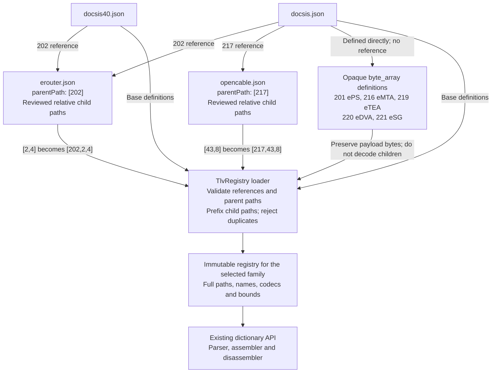

# OSCAR architecture

## Embedded-device catalogs

Status: DOCSIS and DOCSIS 4.0 attach the reviewed eRouter subset.
Regular DOCSIS also attaches OpenCable/eSTB. Selected legacy definitions have moved to shared source catalogs.
eMTA remains subject to verification of its specification and provisioning format.

### Ownership and attachment

Base family catalogs own outer embedded-device containers. Service catalogs own
relative child paths. Each base parent definition carries its own `reference`:
`[202]` references `erouter.json`; regular DOCSIS `[217]` references
`opencable.json`. All reviewed children are loaded. There is no attachment
array, selection allowlist or separate profile file.

`reference` is a local filename, not a URL or JSON Schema `$ref`.
The service's `parentPath` must match the referencing definition.
For example, eRouter `[2,4]` becomes `[202,2,4]`. Base catalogs own applicability.
DPoE, DPoG and DOCSIS 4.0 require separate applicability decisions. eMTA standalone
PacketCable provisioning must not be conflated with embedded DOCSIS settings.

Each family is loaded separately; the diagram does not imply that DOCSIS and
DOCSIS 4.0 definitions are merged. Only regular DOCSIS enables the eSTB reference
and the five opaque placeholders. Composition resolves definitions, not the
order of TLV instances in a configuration file.

### Service catalog contract

All registries use the [common TLV JSON format](tlv-registry-format.md) and
[JSON Schema](tlv-registry.schema.json), including eRouter and OpenCable.
Definitions contain the same `TlvDefinition` fields as DOCSIS: `path`, `name`,
`codec`, `lengthMin`, `lengthMax`, `lengthBytes`, `supportedVersion`,
`maxInstances`, and `description`. No separate `kind`/`length` translation exists.

Embedded catalogs add only a `parentPath` header and relative paths. Their
entries pass through the same strict deserializer and registry validation.
Detailed specification notes and deferred definitions live in the corresponding
skill's `references/tlv-notes.md`, not a second runtime JSON schema. Base
parent references control activation and family applicability.

### Loader composition and validation

The loader validates the base catalog and every service before publishing
an immutable registry. Resolve catalog references only within the configured
catalog root; reject traversal, missing files, unsupported schema versions and
recursive includes. This initial design permits attachments to base containers,
not recursive service-to-service imports.

Validate the attachment is a container, expand relative paths, and reject missing
parents, duplicate paths, case-insensitive sibling-name collisions, invalid lengths
and incompatible codecs. No last-definition-wins merging. Unresolved definitions remain in source notes, outside runtime catalogs; a
missing referenced catalog is rejected. Declare omitted settings
rather than claiming full coverage. Composition changes paths and the inherited
family version, not codec names or payload widths.

Keep the public dictionary API based on full numeric paths. Migrate existing
202 children out of base catalogs atomically with loader activation so definitions
have a single active owner. Preserve existing parser names where compatible;
report changes such as legacy `202.43.11` versus source-defined `202.11` and provide
explicit compatibility/error behavior. Never silently reinterpret an old path.

### Configuration order, integrity and secrets

Definition lookup order is not configuration instance order. Preserve repeated
containers, children, unknown data and encounter order; B.3 treats successive
202 containers as successive portions of one eRouter configuration. Do not sort
instances during composition, editing or export. Recompute MICs only through the
existing configuration integrity pipeline after actual content changes.

Sensitivity metadata applies to display/logging, not stored bytes. Parent hex
previews must respect sensitive descendants. Synthetic credentials are required
for tests and published examples.

### Delivery checklist

- [x] Extract and verify the eRouter I21 source and provenance.
- [x] Define embedded-service ownership and attachment architecture.
- [x] Build the relative-path eRouter catalog with source constraints.
- [x] Add structural and source-boundary catalog regression coverage.
- [ ] Resolve ambiguous widths, access-view range and OID representation.
- [x] Implement direct parent-reference composition and fail-fast validation.
- [x] Remove base-owned service children and document compatibility below.
- [ ] Verify codecs, parser/export integration and value constraints.
- [x] Test subset wire bytes, repeated containers and complete-file MIC round trips.
- [ ] Verify in-memory round trips for every existing family after activation.
- [x] Add DOCSIS 4.0 user examples for the enabled subset.
- [ ] Integrate editor-specific applicability and sensitivity metadata.
- [x] Review OpenCable/eSTB I17 and activate the verified subset beneath 217.
- [x] Verify eSTB SNMP/vendor encodings and repeated instances.
- [ ] Validate eSTB provisioning on hardware and device-specific dependencies.
- [ ] Review eMTA specifications before adding its catalog.

### Enabled eRouter subset

Both base catalogs attach 202.1, 202.2.1–6, 202.3, 202.10, 202.12, 202.13 and
202.42, with the 202.2 container owned by eRouter. Both families use the same
reviewed subset. DPoE is unchanged.

### Compatibility and opaque eSAFE payloads

Legacy unverified DOCSIS definitions 202.43 (including .8/.11), 202.53
(including .1–.4 and .2.1/.2.2), 202.54 (including .1–.4), and 202.2.7
are deferred, not copied into the reviewed catalog. Inputs using these settings
are unsupported and must fail rather than silently dropping their contents.
This is an intentional compatibility restriction pending specification/codec
verification. Standalone 217.8 is removed; the supported VendorID is 217.43.8.
25.14 MaximumDownstreamLatency is grouped after 25.13 in catalog order.

DOCSIS 201 (ePS), 216 (eMTA), 219 (eTEA), 220 (eDVA), and 221 (eSG)
are opaque hex payloads, without invented child definitions. Users supply only
payload bytes; OSCAR writes the outer type and length. Reserved 203–215, 218,
and 222–231 are not assigned placeholder service names. This does not enable
these services in DOCSIS 4.0.

Authority: MULPI I21 C.3.2 delegates assignments to
[CM-SP-eDOCSIS-I30-190213 section 5.2.8.1, Table 5](https://account.cablelabs.com/server/alfresco/2cc53697-0e59-4983-a5ae-c08d4ab70136),
printed pp.46–47. Each opaque instance is bounded to 254 payload octets;
child semantics are not validated. No automatic fragmentation is provided.

D4 uses MULPI I12 Table 117 and C.3.2, p.848, for eSAFE applicability; eRouter
I21 B.3–B.4 supplies type 202 and child encodings. Variable payloads are bounded
by one-octet TLV lengths; no automatic fragmentation is introduced. Registry
metadata describes value constraints; this change does not add a general
cross-field/device-behavior validator.

## Configuration text strings

The ANTLR grammar accepts quoted scalar strings and quoted SNMP values.
`TlvTextString` owns escape decoding, export quoting and quote-aware comment
suppression. This keeps URL punctuation and whitespace out of grammar syntax
while preserving decoded bytes. Generated parser files are regenerated with
ANTLR 4.1; they are not edited manually. Quoted-string JUnit tests cover literal
URL bytes, escapes, nesting, SNMP, malformed input and binary/text round trips.
This parser capability is independent of embedded-service catalog activation.

### OpenCable/eSTB coverage

[opencable.json](../res/tlv-registry/opencable.json) attaches beneath 217 in
regular DOCSIS only. HOST2.1-CFR I17 targets DOCSIS 2.0/3.0 embedded modems;
no D4 attachment is inferred. The regular OSCAR `Docsis` parser uses its common
legacy family (internally named DOCSIS_VER_31); this is not a claim of D3.1 hardware.

All 34 source definitions are attached: IP mode, prefix validation, notification
receivers, SNMP coexistence/access views, VarBind, vendor container/ID and SEB
cipher bitmap. Legacy standalone 217.8 remains for compatibility but the source
places meaningful VendorID at 217.43.8. Opaque vendor child definitions are not
invented. Nested `Snmp11` replaces the unusable legacy `SnmpOID` spelling; scalar
VarBind syntax uses the existing grammar. Vendor data uses nested form, not an
opaque hexadecimal value on the container. Notification numeric fields now use
decimal integers of the specified width (previously raw hexadecimal).

For 217, import creates independent instances in encounter order; export walks
bounded child payloads in wire order and rejects unknown/truncated child data.
It reuses the existing scalar codecs. Other families retain their current parsing
behavior. The existing D4 duplicate-container rejection is a separate TODO.

See [OpenCable verification](opencable-verification.md) for
source interpretations, test coverage, compatibility changes and the hardware
acceptance checklist. Historical cipher assignments are encoding facts, not
recommendations to enable obsolete TLS suites.

## SNMP VarBind naming and editing contract

When adding a specification-backed SNMP VarBind definition, use the OSCAR grammar
statement matching its TLV length field: `Snmp11` for the one-byte-length form,
and `Snmp64` for the two-byte-length form. Length means the outer TLV length
field width, not payload size or the SNMP BER length. Preserve the numeric TLV
path and confirm type/length encoding against the applicable specification;
naming does not authorize changing wire types.

This convention applies to complete SNMP VarBinds (OID, type, value), not bare
OID-valued settings such as access-view subtrees. Do not rename every `oid`
codec entry. New VarBind entries must agree across registry, grammar, parser,
exporter and UI, including nested parent paths. Avoid ambiguous `SnmpOID`
VarBind names. Cover independent wire bytes and binary/text round trips.

The UI presents OID, Type and Value fields for supported VarBind statements.
Validation must wrap nested statements in their actual registry ancestors before
compiling with OSCAR; validating a nested statement at the root is incorrect.
