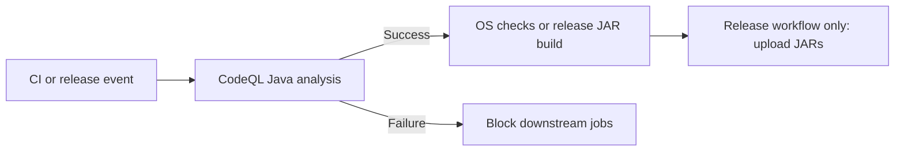

# Development Guide

[README](../../README.md) · [Run the release JAR](Installation.md)

## Checkout and prerequisites

Install Git, a **Java 21 JDK** (including `javac`), Maven, and Python 3.
Use a JDK matching the host architecture. Windows and macOS Java instructions
are in the [installation guide](Installation.md); install Maven separately
using its [official instructions](https://maven.apache.org/install.html).
The repository installer is for Linux, not Windows or macOS.

```bash
git clone https://github.com/Comcast/Oscar.git
cd Oscar
java -version
javac -version
mvn -version
```

On supported Linux hosts, install development prerequisites with:

```bash
./install.sh --development
```

To install prerequisites and build the executable JAR:

```bash
./install.sh --build-oscar-jar
```

The build creates local `oscar.jar` and `latest-build` symlinks into `dist/`.
CI publishes a regular `oscar.jar` file. The development installer also provides
GitHub CLI; authentication and publication are separate actions.

## Build and test

Run from the checkout root (Maven commands also work in PowerShell):

```bash
mvn package
mvn test
```

See [in-memory API round-trip coverage](../api-roundtrip-tests.md) for the
supported configuration editions and focused test command.

The package step runs tests and builds executable and thin JARs. To run the
current executable build on Linux or macOS:

```bash
java -jar target/oscar-3.2.1-all.jar --help
```

In PowerShell use `java -jar .\target\oscar-3.2.1-all.jar --help`.

Full repository validation uses Bash, the formatter, hygiene checks, and Maven:

```bash
tools/run-all.sh
```

Use the repository's Linux development environment for the complete shell
workflow; Maven alone does not run all tooling checks.

## Artifacts and runtime resources

| Artifact | Purpose |
| --- | --- |
| `oscar-all.jar` / `oscar.jar` | Standalone CLI with runtime dependencies |
| `oscar-thin.jar` | Integration library requiring a dependency classpath |

Release assets include individual SHA-256 checksum files. Neither variant
includes examples or test classes. Build a thin-JAR classpath locally with:

```bash
mvn dependency:copy-dependencies -DincludeScope=runtime -DoutputDirectory=target/lib
java -cp "target/oscar-3.2.1.jar:target/lib/*" com.comcast.oscar.cli.Main --help
```

Windows classpaths use `;` instead of `:`. Downloaded thin JARs likewise require
their runtime dependencies; they are not standalone replacements for `oscar.jar`.

See [resource maintenance](../../res/README.md) for the bundled SNMP map and
runtime cache; do not maintain a duplicate map in a consuming application.

| Directory | Contents |
| --- | --- |
| `target/` | Maven output |
| `dist/` | Packaged release artifacts |
| `output/` | Generated examples and test output |

`tools/clean.sh --all` removes generated outputs. Use it only when cleanup is
intended, not as a prerequisite for every build.

## Examples and API development

Use [CLI Examples](CLI-Examples.md) for DOCSIS lab profiles and compile/decompile
commands. The public lab key is not a production credential; `-k` takes a file.
Read [MIC verification](../mic-verification.md),
[SNMP value export](../snmp-value-export.md), and
[DOCSIS 4.0 coverage](../../development/docsis40-implementation.md) for API
behavior and current limitations. Passing fixtures does not establish device
interoperability.

## Version bumps

The release version is defined only in `pom.xml`. Maven generates
`oscar-build.properties`; `BuildInfo.version()` and the CLI banners read it.
Run Maven `process-resources` before launching compiled classes from an IDE;
the legacy Ant build is not a supported version-metadata build path.
Missing or unfiltered metadata fails explicitly instead of reporting a stale version.

Use Python 3 and the bump-only helper to update the POM and current documentation
references. Java source is not rewritten:

```bash
tools/bump-version.sh --bump minor --dry-run
tools/bump-version.sh --bump minor
```

The default is a patch bump; `--bump major`, `--bump minor`, and `--bump patch`
are supported (`maintenance` is an alias for patch). Alternatively, select a
higher numeric version with `--set-version 4.0.0`. The script validates all
input files before writing, preserves unrelated documentation edits, and works
from any directory when invoked by its path. It does not build, commit, tag,
or push, and dry runs leave files unchanged. Review the diff and run
`tools/run-all.sh` before committing and tagging the release.

After committing, ensure a release tag exists locally, or explicitly publish it
to `origin`:

```bash
tools/update-tag.sh --tag v3.2.1
tools/update-tag.sh -t v3.2.1 --push
```

Tags must start with `v` and have three numeric components. Missing local tags
are annotated on the current commit; existing tags are never moved. `--push`
also checks `origin`, fetches remote-only tags, publishes missing remote tags,
and rejects conflicts. Without `--push`, no remote is contacted. The helper
does not bump versions, commit changes, or publish a GitHub release.

## Prepare a release

Commit the intended changes first. The release helper requires a clean working
tree on `main` or `master`. By default it bumps the patch version, runs checks,
builds, commits, tags, and pushes to `origin`:

```bash
python3 tools/release/release.py --bump maintenance
```

Use `--bump minor` or `--bump major` for larger releases. Inspect without changes:

```bash
python3 tools/release/release.py --next-version
python3 tools/release/release.py --dry-run
```

`--no-push`, `--no-tag`, and `--no-commit` control the corresponding Git actions.
Use `--help` for constraints. Preparing a release is separate from publishing
its GitHub release below.

## Publish a GitHub release

Authenticate GitHub CLI after installing development prerequisites:

```bash
gh auth login
gh auth status
```

Publish an existing pushed tag (compatible with older `gh` versions):

```bash
python3 tools/release/publish-release.py --tag v3.2.1 --dry-run
python3 tools/release/publish-release.py --tag v3.2.1
```

This checks the tag on GitHub and creates a published release with generated
notes. The release workflow then builds and uploads the JAR assets. An existing
published release is left unchanged; an existing draft must be reviewed and
published on GitHub. Authentication, network and missing-tag failures stop the
script. `--dry-run` reads GitHub state without publishing.

This publisher does not bump versions, commit, push tags, or build locally.
Use `tools/release/release.py` for local release preparation and
`tools/update-tag.sh --tag v3.2.1 --push` to publish the prepared tag first.

## Documentation maintenance

Keep the root README focused on user installation and links. Maintain setup,
build, release, and resource details here or in focused linked guides. Follow
[documentation-layout](../../skills/documentation-layout/SKILL.md).

Wiki sources live under `docs/wiki/`. Preview with `tools/update-wiki.sh`; see
[wiki publishing](../wiki-publishing.md) before publishing.

## Push branch changes

After committing, run:

```bash
tools/git/git-push.sh --master
```

This checks and pushes only the current main/master branch; it does not create
or publish a release. See the [Git helper guide](../../tools/git/README.md)
for clean-checkout requirements, validation, and retry behavior.

## Registry architecture

See [embedded-device catalog architecture](../architecture.md#embedded-device-catalogs)
for eRouter composition and the planned eSTB/eMTA extension model.

## QA hygiene scope

`tools/run-all.sh` formats handwritten Java, checks changed SPDX headers and years,
runs quality/release helper tests, compiles/packages, verifies both JAR versions,
and runs JUnit. Generated ANTLR sources are excluded from manual formatting and
header checks, but remain compiled and tested. See the
[QA audit](../qa-hygiene-audit.md) for manual checks and remaining legacy gaps.


## CodeQL before CI and release builds

The reusable `.github/workflows/security.yml` analyzes Java using a manual
Maven build with Java 21. Linux, macOS, and Windows CI wait for their CodeQL job
before running OS checks. The release workflow also requires CodeQL before
building and uploading JARs; manual dispatch scans the selected release tag,
not the default branch. Each workflow invokes its own prerequisite scan.

Analysis failure or cancellation blocks downstream jobs. Findings are uploaded
to GitHub Security; a completed scan with alerts does not automatically fail
this gate. Alert severity policy is separate. Disable GitHub default CodeQL
setup if enabled to avoid duplicating this advanced setup.

The release workflow starts after publication, so this gates JAR asset uploads,
not creation of the release page itself. Actual CodeQL execution requires GitHub
CI; local workflow lint does not establish a clean security scan.




### Windows CI

`ci-windows.yml` runs on Windows 11 ARM with x64 Temurin Java 21 under
emulation. After CodeQL succeeds, `mvn -B clean verify` builds the JARs and
runs JUnit tests. Surefire reports are retained even on failure. The README's
Windows badge links to this workflow; it does not claim native x64 hardware
testing or MSI coverage (OSCAR distributes JARs). Unix shell quality checks
remain in Linux/macOS CI. This workflow runs on pushes, pull requests, and
manual dispatch; it does not publish releases.


### Recheck an up-to-date branch

Use `tools/git/git-push.sh --master --force-push` to run local checks even
when origin already has the current commit. This option never passes Git's
force flag, overwrites tags, bypasses checks, or permits uncommitted changes.
The no-change message suggests this option; dirty checkouts still require
committing or stashing first.
